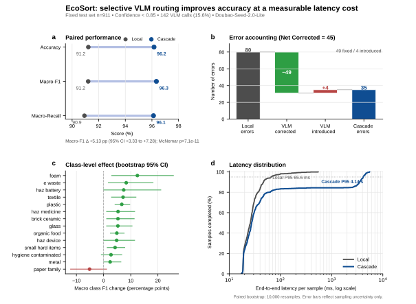

# ♻️ EcoSort: Edge-Cloud Waste Classification for Real-World Deployment

[](https://www.python.org/downloads/)
[](#)
[](https://opensource.org/licenses/MIT)

[Portfolio results](docs/portfolio/index.html) · [Experiment report](reports/ecosort_experiment_report.md) · [Reproduction guide](reports/EXPERIMENT_REPRO.md)

---

## Project Summary

EcoSort is a student-built computer vision system designed to classify everyday waste under realistic constraints, not only benchmark-friendly conditions. The project focuses on practical engineering decisions: class remapping, robust preprocessing, edge-ready inference, and cloud-assisted fallback when confidence is low.

This repository includes end-to-end components:

- data and mapping configurations,
- training and evaluation pipelines,
- a Flask inference backend,
- an interactive demo interface,
- deployment-ready model packaging.

The core objective is to make waste classification reliable in real usage scenarios, where images are noisy, classes are imbalanced, and deployment resources are limited.

## Verified Local–VLM Cascade Result

The final experiment keeps the local checkpoint and routing threshold fixed. On the 911-image test set after confirmed exact-duplicate exclusion, only samples with `confidence < 0.85` are routed to `doubao-seed-2-0-lite-260428`.

| Method | Accuracy | Macro Precision | Macro Recall | Macro-F1 | VLM call rate | P95 latency |
|---|---:|---:|---:|---:|---:|---:|
| Local EfficientNet-B3 | 91.218% | 91.723% | 90.927% | 91.208% | 0% | 65.6 ms |
| Local + uncertainty routing + VLM | **96.158%** | **96.744%** | **96.117%** | **96.337%** | **15.587%** | **4.14 s** |

- 142 real VLM calls: 140 successful mappings and 2 failures with the local prediction retained.
- 49 local errors corrected, 4 new errors introduced, **Net Corrected = 45**.
- Paired Macro-F1 gain: **+5.13 percentage points** (10,000-bootstrap 95% CI +3.33 to +7.28 pp).
- Exact paired McNemar test: **p = 7.05 × 10⁻¹¹**.



The figure deliberately shows the downside as well as the gain: overall P50 remains 27.4 ms because 84.4% of samples stay local, while network-bound P95 rises to 4.14 s.

---

## Why This Project Matters

Many waste classification demos report high accuracy on simplified datasets but fail in real environments. EcoSort was built to close that gap. The project addresses four practical challenges:

1. **Taxonomy mismatch** between research datasets and local sorting behavior.
2. **Class imbalance and distribution shift** that inflate benchmark metrics.
3. **Edge inference constraints** in memory, latency, and model size.
4. **Ambiguous samples** that require human-in-the-loop or cloud verification.

Instead of optimizing only for one headline metric, EcoSort prioritizes robustness and deployment feasibility.

---

## Technical Contributions

### 1) Data-Centric Taxonomy Engineering

The class design evolved from broad category baselines to a practical 14-class scheme for daily usage. Several classes were merged or split based on visual confusion and disposal semantics.

Examples:

- Hazard-like chemicals were merged into plastic-related handling where visual overlap dominated errors.
- A mixed residual class was decomposed into more consistent subgroups such as `small_hard_items`, `foam`, and `brick_ceramic`.
- Hygiene-contaminated classes were grouped for operational relevance.

This remapping reduced confusion concentration and improved per-class stability.

### 2) EfficientNet-B3 for Edge-Oriented Inference

The final model family centers on EfficientNet-B3 due to favorable performance-to-compute trade-offs. The architecture choice balances representation power and deployment practicality.

### 3) Letterbox Preprocessing for Aspect-Ratio Robustness

EcoSort uses longest-side resize with padding to preserve object shape cues for elongated or irregular items. This is critical for classes where geometric distortion from naive resizing causes systematic errors.

### 4) Edge-Cloud Cascade Design

Local inference serves as the primary path for speed and cost control. A cloud VLM fallback can be triggered for difficult cases, creating a practical reliability layer without forcing all requests through a remote model.

### 5) Feedback Loop for Continuous Improvement

The demo includes edge-case reporting to capture misclassifications and uncertain samples, enabling iterative dataset updates and future model versions.

---

## Repository Structure

```text
ecosort_web_source/
├── backend/                # Flask API for inference and optional VLM fallback
├── src/                    # Core modules: data, models, train, utils
├── experiments/            # Training and evaluation entry points
├── configs/                # Model, training, and mapping configurations
├── scripts/                # Utility scripts for automation and analysis
├── docs/portfolio/         # Offline recruiter-facing result page
├── reports/                # Audited report, machine metrics, and QA records
├── hf_space/               # Hugging Face Space adapter
├── checkpoints/            # Git LFS model artifact or download target
├── data/sample/            # Dataset directory template
├── render.yaml             # Render deployment definition
├── environment.yml         # Conda environment definition
└── requirements.txt        # Pip dependency list
```

---

## Quick Start

### 1) Environment Setup

```bash
conda env create -f environment.yml
conda activate ecosort
pip install -r requirements.txt
```

### 2) Training

```bash
python experiments/train_baseline.py \
  --config configs/ecosort_v5_14class_effb3_letterbox224.yaml \
  --data-root data/raw
```

### 3) Evaluation

```bash
python experiments/evaluate.py \
  --checkpoint checkpoints/best_model.pth \
  --data-root data/raw \
  --model-type efficientnet
```

### 4) Run Backend API

```bash
python backend/app.py \
  --model-path checkpoints/best_model.pth \
  --host 0.0.0.0 \
  --port 5000
```

### 5) View Verified Results Without a Model or API Key

```bash
python -m http.server 8000
# open http://localhost:8000/docs/portfolio/
```

---

## Auditable Evaluation Artifacts

The public portfolio bundle contains sanitized aggregate metrics, per-class deltas, routed transitions, bad-case identifiers, checksums, and an offline HTML result page. Raw API caches, request identifiers, API keys, host paths, checkpoints, and source images are intentionally excluded.

```bash
conda run -n cptac python scripts/analyze_ecosort_cascade_robustness.py
conda run -n cptac python scripts/export_ecosort_portfolio_data.py
conda run -n cptac python scripts/plot_ecosort_cascade_portfolio.py
```

## Mapping and Class Definition Notes

The final deployment-oriented taxonomy uses 14 classes and maps fine-grained raw labels into operational groups. This design reflects both visual discriminability and disposal relevance.

Current local model classes:

- `brick_ceramic`
- `e_waste`
- `foam`
- `glass`
- `haz_battery`
- `haz_device`
- `haz_medicine`
- `hygiene_contaminated`
- `metal`
- `organic_food`
- `paper_family`
- `plastic`
- `small_hard_items`
- `textile`

At inference time, classes can also be mapped to coarse categories (`recyclable`, `hazardous`, `kitchen`, `other`) for user-facing guidance.

---

## Engineering Highlights for AI Application Roles

This project demonstrates practical software and ML engineering skills across the full stack:

- **Data engineering:** custom mapping rules, dataset auditing, and class balancing decisions.
- **Modeling:** architecture selection with explicit compute-performance trade-offs.
- **MLOps mindset:** checkpoint organization, reproducible experiments, and result packaging.
- **Deployment engineering:** lightweight API service, bounded cloud calls, durable cache/ledger semantics, and failure-safe local retention.
- **Human-centered design:** interactive correction loop and fallback path for uncertain predictions.

The project is not a single notebook experiment. It is a multi-stage system with iterative design decisions, measurable trade-offs, and deployment constraints.

---

## Deployment Notes

- The recruiter-facing result page is static and works without an API key: `docs/portfolio/index.html`.
- Model weights use Git LFS or an explicit download URL; a pointer file is not a runnable checkpoint.
- The published metrics use champion SHA256 `9ba817cdf0712b597e1eb322d722e130707d60d6733cf46d8d87149456946234`; runtime health checks must report the same hash before claiming audited parity.
- API keys are read from environment variables or protected local files and never exported with public results.
- The completed experiment used a permanent 142-attempt ledger; reruns cannot silently exceed that budget.

---

## Reproducibility and Artifact Policy

- Large datasets and full checkpoints are intentionally not committed as standard Git blobs.
- Raw experiment outputs remain local; only the sanitized portfolio bundle is intended for Git.
- Training states should include model weights and optimizer/scheduler context for restartability.
- Mapping and training settings are versioned in `configs/` for traceability.

---

## Limitations

- The paired confidence intervals quantify sampling uncertainty on one fixed test set, not distribution or provider drift.
- One request exceeded the provider pixel limit and one response returned the unmapped open-set label `trash`; both retained the local prediction.
- Directory-level labels mix material, object identity, and disposal semantics, especially for tissue, tea, and mixed-object images.
- The result covers one local checkpoint, one VLM version, and one validation-selected threshold.

---

## Future Work

- Build an independently labeled calibration/audit subset for the ambiguous directory mappings.
- Add provider-drift monitoring before treating cloud outputs as a stable production dependency.
- Align the product demo with the audited 224-letterbox local preprocessing and 0.85 routing rule.
- Evaluate asynchronous review or timeout-aware fallback for stricter latency SLAs.

---

## Acknowledgments

This project was developed as part of a student-led effort to bridge machine learning research and practical deployment. The work emphasizes reproducibility, iterative problem solving, and user-facing reliability.

For a compact review, start with `docs/portfolio/index.html` and the machine-readable files under `docs/portfolio/data/`.
