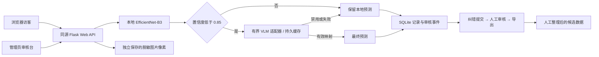

# 本科毕业设计选题与实施范围

建议题目：**基于置信度路由与视觉语言模型协同的垃圾分类系统设计与实现**。

该题目与已经实现的技术路线一致，侧重软件工程的需求、架构、业务闭环、测试与可复现分析。尚未提供学院任务书或评分表，本文是项目实施方案，不代表学院已批准题目或保证成绩。

## 研究问题与工作边界

本地视觉模型可以快速处理大部分垃圾图片，但部分低置信度样本容易出错。系统研究如何仅将这部分样本交给视觉语言模型，在分类效果、响应时间、外部调用量之间作出可解释的取舍；同时实现识别、留痕、纠错、审核与统计。

既有固定实验：14 类、224 letterbox、EfficientNet-B3、置信度 `<0.85` 路由；排除确认跨集合精确重复后的测试集 N=911。本地 Macro-F1=91.208%，级联 Macro-F1=96.337%；真实请求 142 次、净修正 45 例，代价为 P95 延迟约 4.14 秒。原始证据见 `reports/ecosort_experiment_report.md`。这些是 2026 年 8 月的固定实验结果，不是新增业务记录的实时准确率。

不宣称原创网络结构；不把现成 EfficientNet、letterbox、置信度或 VLM API 本身作为原创算法。不宣称已经验证手机、树莓派或其他端侧性能；原实验速度来自 NVIDIA L20。不把轮廓候选裁剪描述为经过检测标注集验证的目标检测。

## 需求与验收映射

| 编号 | 需求 | 验收方式 |
|---|---|---|
| FR-01 | 单图识别并记录本地预测、最终预测与复核路径 | HTTP 流程测试、真实权重识别 |
| FR-02 | 批量识别、逐项报告无效图片、限制批量规模 | HTTP 批量及异常输入测试 |
| FR-03 | 保存原图像素、时间、标签、置信度与耗时；分页筛选与 CSV 导出 | 持久化、分页、导出与重启测试 |
| FR-04 | 访客只能访问当前签名会话的记录及图片 | 两个独立客户端交叉访问测试 |
| FR-05 | 用户提交合法标签和纠错理由，不覆盖模型输出 | 纠错验证、重复提交测试 |
| FR-06 | 管理员查看纠错队列、采纳或驳回并保留审核意见 | 完整审核流程、权限、并发冲突测试 |
| FR-07 | 业务分类分布、待审/采纳数量；管理员可查看全站 | 统计及权限测试 |
| FR-08 | 导出人工采纳的纠错供后续整理 | 已审核导出与 CSV 公式转义测试 |
| NFR-01 | 云服务失败或未开启时保留本地预测，调用有持久预算与缓存 | 原有级联、缓存、预算及崩溃恢复测试 |
| NFR-02 | 防止测试集回退为训练全集，损坏图像不得静默替换为空白 | 数据加载器合同测试 |
| NFR-03 | 新建数据集先排重再分层切分，不覆盖原目录 | 数据构建器测试 |
| NFR-04 | 限制输入大小、阻止跨站写入、不暴露内部异常 | HTTP 安全及错误处理测试 |

## 系统架构

数据实体：records 为原始识别记录，feedback 为一条记录对应的一次纠错，audit_events 为记录创建、纠错和审核的事件序列。记录与纠错采用外键关联。审核采用状态与版本号条件更新，避免两个审核者相互覆盖。图片不放在公开静态目录中，读取时检查会话归属或管理员权限。

## 论文建议章节

1. 绪论：应用背景、问题、相关工作、本文工作及边界。
2. 需求分析：角色、用例、功能与非功能需求、验收指标。
3. 系统设计：模块、数据模型、API、级联和异常处理流程。
4. 系统实现：模型集成、业务持久化、纠错审核、缓存预算、网页。
5. 系统测试与实验分析：功能与权限测试、固定测试集对照、路由消融、调用量和延迟、坏例与数据泄漏敏感性。
6. 总结与展望：实际完成的工作、限制与改进。

## 仍须在论文中说明

- 原训练期 validation 含一个与训练集精确重复的样本；事后删除不能撤销潜在的 epoch 选择影响。
- dHash 近重复候选不等于已确认泄漏；原始数据来源和使用许可仍需逐来源整理。
- 当前消融没有证明 Margin/Entropy 相对置信度有增量收益。
- 目录标签混合了材质、物品及处置语义；四大类是项目规则，不代表所有地区的分类规定。
- 访客识别记录依赖浏览器 Cookie，不提供跨设备账号同步；演示部署通过 SSH 访问，尚非公众开放的多租户服务。
- 审核通过只是人工采纳意见，不是经过独立标注一致性验证的金标准；不自动进入训练集。
- 新数据构建器和加载器已收紧错误处理，但本轮不重训、不替换历史 champion、不产生新的精度结论。
