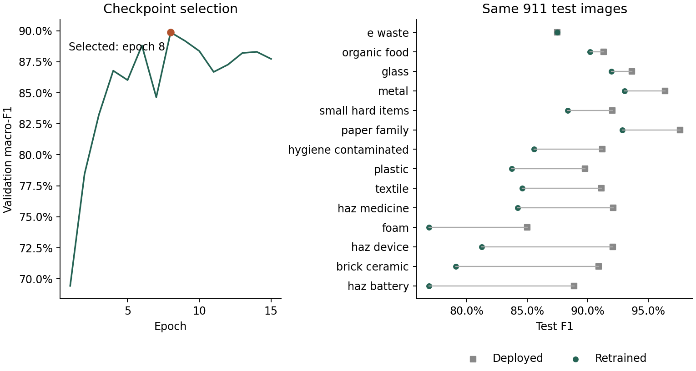

# EfficientNet-B3 清理数据重训验证

本轮候选未达到现役模型的准确率和 Macro-F1，保留现役权重。

使用一张 NVIDIA L20，训练进程用时 11.3 分钟（包括训练、验证和保存，不含输入准备与最终评测）。共运行 15 轮，按验证集 Macro-F1 选择第 8 轮，选中值 89.87%。

| 模型 | Accuracy | Macro-F1 | 低于原复核阈值 0.85 |
|---|---:|---:|---:|
| 新 B3 | 86.39% | 85.44% | 242/911 |
| 现役 B3 | 91.44% | 91.39% | 139/911 |

相对现役 B3，新模型改对 21 张、改错 67 张。准确率差的样本级配对 bootstrap 95% 区间：[-7.03, -3.07] 个百分点。

数据与边界：固定清单（7,206/895/911），逐文件复算 SHA-256，与上次审计的清单一致。保留生产模型作为冻结对照，不以旧权重初始化新模型。训练沿用项目 V6 配置：ImageNet 预训练、14 类、224 像素、batch 24、AdamW、混合精度、加权采样、30 轮上限、连续 7 轮验证未改善则停止。测试只在验证选模结束后比较，两模型对相同输入都采用 GPU FP32，batch 32。原阈值仅用于描述请求比例，未针对新模型做标定，未实际调用云端复核。测试图与此前实验相同，不代替新场景盲测。单个种子的差异不能解释为清理数据的因果效应。

| 类别 | 样本 | 新 F1 | 现役 F1 |
|---|---:|---:|---:|
| brick_ceramic | 40 | 79.12% | 90.91% |
| e_waste | 24 | 87.50% | 87.50% |
| foam | 20 | 76.92% | 85.00% |
| glass | 44 | 91.95% | 93.62% |
| haz_battery | 14 | 76.92% | 88.89% |
| haz_device | 33 | 81.25% | 92.06% |
| haz_medicine | 39 | 84.21% | 92.11% |
| hygiene_contaminated | 96 | 85.56% | 91.21% |
| metal | 41 | 93.02% | 96.39% |
| organic_food | 167 | 90.18% | 91.29% |
| paper_family | 43 | 92.86% | 97.62% |
| plastic | 186 | 83.75% | 89.78% |
| small_hard_items | 77 | 88.34% | 92.02% |
| textile | 87 | 84.62% | 91.11% |

在原阈值 0.85 下，分别用每个模型自己的分类错误作为分母：

| 模型 | 分类错误 | 其中送复核 | 未送复核的错误 |
|---|---:|---:|---:|
| 新 B3 | 124 | 102 | 22 |
| 现役 B3 | 78 | 53 | 25 |

此表只检查路由是否覆盖错误，不假设云端模型能纠正所有送审样本。

历史研究目录按图片扩展名枚举样本，当前实现对文件名排序；配合加权随机采样，即使种子相同，样本顺序也可能不同。不能把分差归因于移除几张图。若要拆分原因，下一轮应在同一版加载器、相同训练预算与多个预设种子下，比较原始与清理后的训练清单，只在验证集上分析变化。

[实验复现步骤](../../experiments/clean_b3/README.md) · [逐类指标及模型 SHA-256](paired.json)
