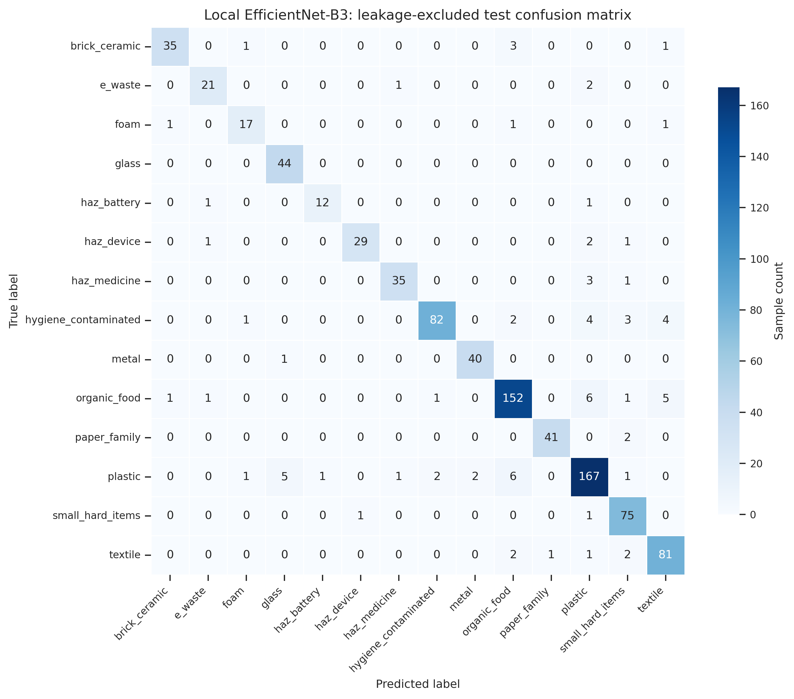
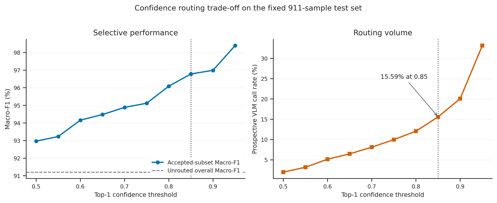
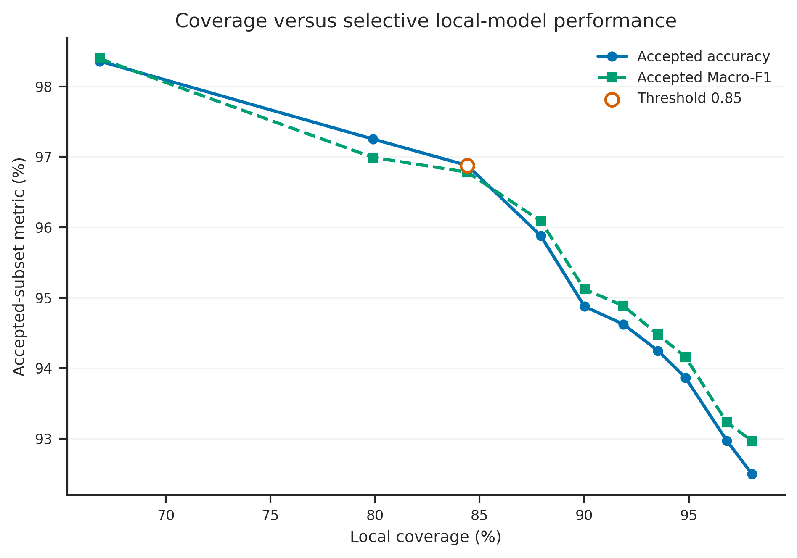
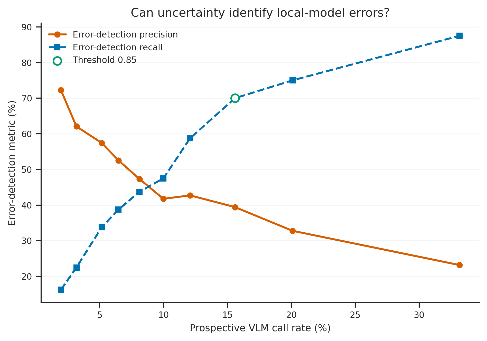
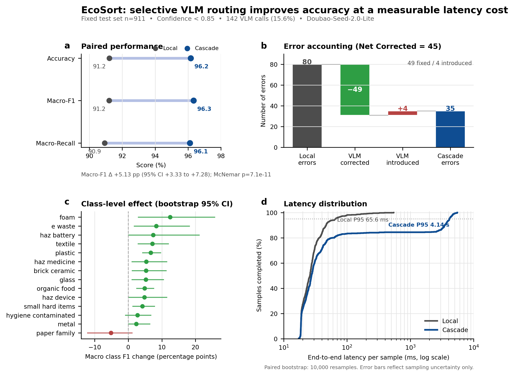

# EcoSort 不确定性路由与 VLM Fallback 实验报告

> 状态：完整可审计交付（固定 Confidence-only 0.85 路由与真实 Doubao-Seed-2.0-Lite cascade 已完成） 
> 实验日期：2026-08-09 至 2026-08-10 
> 主测试集：剔除确认跨 split 精确重复后的 911 个样本 
> 结论边界：VLM 分类、usage 与网络延迟均来自 142 次真实 Ark API 请求；没有真实价格配置，因此不换算金额。

## 1. Problem

本轮研究问题是：相比单独使用本地视觉模型，能否通过不确定性路由只把少量困难样本交给 VLM，在提高 14 类垃圾分类整体效果的同时，形成效果、延迟和调用量之间可解释的 trade-off。

当前证据支持完整链路：本地模型的不确定性能够筛出相当一部分错误；只对 `confidence < 0.85` 的 15.587% 测试样本调用 Doubao-Seed-2.0-Lite 后，整体 Accuracy 与 Macro-F1 均取得明确净提升。

核心阶段结论如下。

1. 本地 EfficientNet-B3 在测试端排除确认精确重复后取得 **91.218% Accuracy、91.208% Macro-F1**；训练期 validation 中的 1 个重复可能已影响 checkpoint 选择，无法事后完全消除。
2. 验证集选出的 `confidence < 0.85` operating point 在测试集路由 **142/911（15.587%）** 样本，捕获 **56/80（70.0%）** 本地错误；接受子集 Accuracy 为 96.879%，Macro-F1 为 96.783%。
3. Margin 与 Entropy 在当前阈值下没有增加错误捕获；当前完整策略仅比 Confidence-only 多拒绝 1 个预测正确的 `e_waste` 样本。
4. 固定 Confidence-only 计划真实调用 **142/911（15.587%）**，140 次成功映射、2 次失败并保留 local；Macro-F1 从 **91.208% 提升至 96.337%**，Accuracy 从 **91.218% 提升至 96.158%**。
5. VLM 修正 49 个本地错误、引入 4 个新错误，Net Corrected=45；全测试集 Cascade P95 为 4.140 s，总 usage 为 246,313 tokens（141/142 次返回 usage）。本轮不重新训练。

## 2. Dataset / Split

### 2.1 数据与标签空间

固定数据目录为 `data/proc/ecosort_v6_15class`，checkpoint 实际使用 14 个目标类：

`brick_ceramic, e_waste, foam, glass, haz_battery, haz_device, haz_medicine, hygiene_contaminated, metal, organic_food, paper_family, plastic, small_hard_items, textile`。

原始 split 规模如下。

| Split | Raw N | Exact duplicate removed | Analysis N |
|---|---:|---:|---:|
| Train | 7,210 | 0（未重训） | 7,210 |
| Validation | 896 | 1 | 895 |
| Test | 912 | 1 | 911 |

### 2.2 数据泄漏审计

审计当前所有符号链接、canonical source path、SHA256 和 64-bit dHash：当前链接均有效，且未发现跨 split 的相同 canonical source path；发现 2 个确认的 SHA256 跨 split 重复组。训练 split 内另有 2 个重复冗余样本，不构成跨 split 泄漏，但可能轻微改变训练样本权重。

- Train ↔ Test：`test/haz_battery/haz_battery_000002.jpg` 与一个训练样本完全相同。
- Train ↔ Validation：`val/haz_battery/haz_battery_000010.png` 与一个训练样本完全相同。

阈值选择与测试主分析将两者分别从 validation 和 test 排除。需要区分的是，champion 已在含该 train–validation 重复的原始 validation 上完成 epoch 选择；事后删除样本不能回溯证明同一 epoch 仍是无泄漏最优点。该风险只涉及 1/896 个 validation 样本，影响可能较小但目前无法量化。dHash 层面共标记 47 个跨 split 候选组，其中包含上述 2 个精确重复组；dHash 只能提示视觉近重复，不能证明文件或语义重复，因此不从主分析直接删除。

作为敏感性分析，在测试端先排除确认精确重复后，911 个主测试样本中仍有 28 个 dHash 候选；进一步排除它们后 N=883，Accuracy 从 91.218% 降至 90.940%（−0.278 个百分点），Macro-F1 从 91.208% 降至 90.941%（−0.267 个百分点）。28 个候选在主测试中均预测正确，说明近重复可能轻度抬高结果，但不足以把候选全部定性为泄漏。

完整 leakage manifest 保留在本地审计目录，不进入公开 portfolio（其中含源文件路径）；公开报告保留聚合计数、重复样本 ID 与敏感性结果。

## 3. Local Model

### 3.1 Checkpoint 与推理路径

本轮复用 `checkpoints/champion_ecosort_target_20260301/best_model.pth`，不重新训练。checkpoint SHA256 为：

`9ba817cdf0712b597e1eb322d722e130707d60d6733cf46d8d87149456946234`

该文件与 `checkpoints/train_ecosort_v6_15class/best_model.pth` 哈希一致；训练摘要显示最佳原始 validation Macro-F1 出现在 epoch 24。模型为 EfficientNet-B3，输入采用 224×224 letterbox，单图 batch=1，NVIDIA L20 上 FP16 autocast，20 次 warmup。checkpoint 未保存 `model.type/backbone`，B3 由 state_dict 结构、对应训练日志与外部配置共同确认；推理脚本现已显式记录 effective model spec 与配置 hash。

训练日志审计还发现一个必须区分的旧运行：`pipeline_ecosort_v6_15class_effb3_letterbox224_20260301_011559` 记录了 16,127 条 `Error loading`，数据集异常路径会用纯白图代替；但它产出的 checkpoint SHA256 为 `779082...`，与本轮 champion 不同。与 champion 对应的 `train_ecosort_v6_14class_effb3_20260301_012203.log` 中 `Error loading` 为 0。因此不能把旧运行的白图风险归因到当前 champion，但未来任何重训前仍应删除这种静默替代逻辑或将读取失败设为 hard error。

### 3.2 Baseline 总体指标

| Metric | 结果 |
|---|---:|
| Accuracy | 91.218% |
| Macro Precision | 91.723% |
| Macro Recall | 90.927% |
| Macro F1 | 91.208% |
| 错误数 | 80 / 911 |

### 3.3 Confusion Matrix

最大无向混淆对为 `organic_food ↔ plastic`，共 12 个，占全部错误 15.0%。随后是 `organic_food ↔ textile` 7 个、`hygiene_contaminated ↔ plastic` 6 个、`plastic → glass` 5 个。前四组共 30/80，占 37.5%。

### 3.4 每类指标

| Class | Precision | Recall | F1 | Support |
|---|---:|---:|---:|---:|
| brick_ceramic | 94.59% | 87.50% | 90.91% | 40 |
| e_waste | 87.50% | 87.50% | 87.50% | 24 |
| foam | 85.00% | 85.00% | 85.00% | 20 |
| glass | 88.00% | 100.00% | 93.62% | 44 |
| haz_battery | 92.31% | 85.71% | 88.89% | 14 |
| haz_device | 96.67% | 87.88% | 92.06% | 33 |
| haz_medicine | 94.59% | 89.74% | 92.11% | 39 |
| hygiene_contaminated | 96.47% | 85.42% | 90.61% | 96 |
| metal | 95.24% | 97.56% | 96.39% | 41 |
| organic_food | 91.57% | 91.02% | 91.29% | 167 |
| paper_family | 97.62% | 95.35% | 96.47% | 43 |
| plastic | 89.30% | 89.78% | 89.54% | 186 |
| small_hard_items | 87.21% | 97.40% | 92.02% | 77 |
| textile | 88.04% | 93.10% | 90.50% | 87 |

## 4. Uncertainty Routing

### 4.1 审计到的现有指标

本轮没有添加新的 uncertainty 指标，只复现现有 Streamlit strict threshold 公式：

- Top-1 Confidence：`max(p)`；低于阈值时拒绝。
- Top1–Top2 Margin：最高与次高概率差；低于阈值时拒绝。
- Normalized Entropy：`−Σ p log p / log(K)`；高于阈值时拒绝。
- Hazardous-class guard：预测为危险类且置信度低于特殊阈值时拒绝。

现有实现存在三个事实差异。根 `backend/app.py` 的产品推理只用 `confidence < 0.7` 并由用户手动触发 AI review；完整 Confidence + Margin + Entropy + Hazard guard 位于 `streamlit_demo.py`，但只返回 review-needed，不自动调用 VLM。后者的 hazardous 集合仍是旧标签，V6 14 类中只有 `e_waste` 能命中，`haz_battery / haz_device / haz_medicine` 均不会命中。此外，Streamlit 实际使用 300×300 直接 Resize、CPU/FP32，而本实验使用 checkpoint 对应的 224 letterbox、L20 FP16；因此下文 `Current full` 表示“Streamlit 阈值逻辑施加于标准化 checkpoint 输出”，不是当前 Streamlit 端到端行为。

### 4.2 A–D Ablation（固定默认阈值，Test）

| Strategy | Coverage | Route rate | Errors caught | Acc_sel | F1_sel | ED-Precision | ED-Recall |
|---|---:|---:|---:|---:|---:|---:|---:|
| A. Confidence | 84.413% | 15.587% | 56 / 80 | 96.879% | 96.783% | 39.437% | 70.000% |
| B. + Margin | 84.413% | 15.587% | 56 / 80 | 96.879% | 96.783% | 39.437% | 70.000% |
| C. + Entropy | 84.413% | 15.587% | 56 / 80 | 96.879% | 96.783% | 39.437% | 70.000% |
| D. Current full | 84.303% | 15.697% | 56 / 80 | 96.875% | 96.754% | 39.161% | 70.000% |

拒绝本身不产生替代预测，因此表中的 Accepted Acc / Macro-F1 只描述被本地模型接受的子集，不能当作系统 Overall 指标。若仍保留被拒样本的原本地预测，则 Overall Accuracy / Macro-F1 仍是 91.218% / 91.208%。

A、B、C 的决策完全相同，说明在当前默认阈值和当前预测分布上，Margin 与 Entropy 没有提供 Confidence 之外的增量。D 只多拒绝一个预测正确的 `e_waste`，没有多捕获错误。当前最简洁的 operating strategy 因而是 A，而不是完整 D。

### 4.3 Threshold Sweep（Confidence-only）

阈值候选在排除确认精确重复的 validation（N=895）上选择，再一次性应用到 test；没有根据 test 结果反向调阈值。

| Threshold | Coverage | Route rate | Acc_sel | F1_sel | ED-Precision | ED-Recall |
|---:|---:|---:|---:|---:|---:|---:|
| 0.50 | 98.024% | 1.976% | 92.497% | 92.967% | 72.222% | 16.250% |
| 0.55 | 96.817% | 3.183% | 92.971% | 93.232% | 62.069% | 22.500% |
| 0.60 | 94.841% | 5.159% | 93.866% | 94.159% | 57.447% | 33.750% |
| 0.65 | 93.524% | 6.476% | 94.249% | 94.478% | 52.542% | 38.750% |
| 0.70 | 91.877% | 8.123% | 94.624% | 94.886% | 47.297% | 43.750% |
| 0.75 | 90.011% | 9.989% | 94.878% | 95.122% | 41.758% | 47.500% |
| 0.80 | 87.925% | 12.075% | 95.880% | 96.090% | 42.727% | 58.750% |
| **0.85** | **84.413%** | **15.587%** | **96.879%** | **96.783%** | **39.437%** | **70.000%** |
| 0.90 | 79.912% | 20.088% | 97.253% | 96.992% | 32.787% | 75.000% |
| 0.95 | 66.850% | 33.150% | 98.358% | 98.395% | 23.179% | 87.500% |

### 4.4 Operating Point

建议的路由 operating point 是 **Confidence-only，threshold=0.85**。

- Validation：路由 110/895（12.291%），错误检测 Recall 69.811%，Precision 33.636%。
- Test：路由 142/911（15.587%），错误检测 Recall 70.000%，Precision 39.437%，错误检测 F1 50.450%。
- 相比 0.90，0.85 少约 4.5 个百分点的预期调用量，只少捕获 4/80 个本地错误；相比 0.75，则多约 5.6 个百分点调用量并多捕获 18/80 个错误。

这个点证明路由有筛错能力，但不证明被路由样本一定能被 VLM 修正。

## 5. VLM Cascade

### 5.1 现有实现与复用边界

根 `backend/app.py` 定义了现有 42 类 VLM 任务。本轮保持该任务语义和 `configs/dataset_mapping.yaml` 不变，仅把真实 provider 固定为 `doubao-seed-2-0-lite-260428`。41 个原始类可映射到 V6 14 类；唯一无映射输出是已从 V6 删除的 `trash`。公平评测只采用 VLM Top-1；非法输出、`trash` 或 API 错误标记为 failure，最终保留 local 预测。

`delivery/clean_github_upload` 是 V5 部署快照，自动 fallback 只输出 4 个粗类，不能用于本轮 14 类 Macro-F1；HF Space 也明确不调用云 VLM。因此没有把旧部署结果冒充为 V6 cascade。

此前 Gemini 试运行因免费限额中止且样本不完整，其 cache 保留在独立目录 `reports/ecosort_experiment_results/vlm`，不参与本轮 Seed2.0-Lite 正式结果。

### 5.2 安全调用计划

固定调用计划采用已选定的 Confidence-only `confidence < 0.85`：142/911（15.587%）。独立 Seed harness 具备：

- 默认 dry-run，必须显式 `--execute` 才会请求外部 API；
- 结果 cache 与永久预算账本分离；model、prompt、mapping 或图像变化只会使结果不可复用，不会返还已消耗预算；
- 每次请求前先在独占文件锁内写入带 `attempt_id` 的 reservation 并 `fsync`；在固定默认 output directory 且不删除账本的前提下，所有并发进程共享累计 142 次 generation-attempt 上限；
- 若进程在请求后崩溃，未完成 reservation 会保守占用额度且禁止自动重试，从而避免重复收费；显式重试也只能消耗剩余累计预算；
- cache key 包含 sample ID、图像 SHA256、model、helper 源码 hash 和映射文件 hash；
- 每次返回结果单独写入 JSONL + flush + fsync，支持中断恢复；
- 单次 wall timeout 120 秒；
- 通过受保护文件读取 key，`requests.Session(trust_env=False)` 避免代理污染，key 不写入结果文件或日志。

执行状态：先完成 1-call smoke，再断点续跑其余 141 个样本；最终 ledger=142、cache=142、悬空 reservation=0。140 次成功映射；1 次返回 `trash` 无法映射，1 次因图像超过 Ark 输入限制返回 HTTP 400，两者均保留原 local 预测且未重试。

### 5.3 Cascade 结果状态

| Method | Acc | Macro-P | Macro-R | Macro-F1 | VLM rate | P95 |
|---|---:|---:|---:|---:|---:|---:|
| Local EfficientNet-B3 | 91.218% | 91.723% | 90.927% | 91.208% | 0% | 65.6 ms |
| + Seed cascade | **96.158%** | **96.744%** | **96.117%** | **96.337%** | **15.587%** | **4.140 s** |

142 个 routed 样本中原有 56 个 local error。VLM 修正 49 个、未修正 7 个；86 个原本正确样本中 4 个被改错，Net Corrected=45。公开机器结果统一收录于 [summary.json](../docs/portfolio/data/summary.json)。

### 5.4 配对统计稳健性

在不改变模型、路由阈值或任何逐样本预测的前提下，对 911 个成对的 Local/Cascade 结果进行 10,000 次样本级 paired bootstrap（seed=20260811），并对正确性变化执行 exact McNemar test。

| Paired delta | Point estimate | Bootstrap 95% CI |
|---|---:|---:|
| Accuracy | +4.940 pp | [+3.403, +6.476] pp |
| Macro Precision | +5.021 pp | [+2.912, +7.346] pp |
| Macro Recall | +5.190 pp | [+3.235, +7.448] pp |
| Macro-F1 | **+5.129 pp** | **[+3.328, +7.275] pp** |

53 个 Local 与 Cascade 结果不一致的样本中，49 个是 Local wrong→Cascade correct，4 个是 Local correct→Cascade wrong；exact McNemar 双侧 `p=7.054e-11`。在 142 个 routed 样本内部，Accuracy 从 60.563% 提升至 92.254%（+31.690 pp）。因此，固定测试集上的净提升具有明确配对统计证据，不是由少数随机翻转即可解释。

置信区间只量化该固定测试集的抽样不确定性，不覆盖标签噪声、阈值选择、数据分布漂移、VLM provider/version 漂移或未来网络状态。逐类分析显示 14 类中 13 类点估计提高，但 `paper_family` F1 下降 5.166 pp，主要因为部分 `tissue` 图像被 VLM 视觉合理地判为纸类却与目录映射标签冲突。

公开机器结果：[summary.json](../docs/portfolio/data/summary.json)、[per_class_delta.csv](../docs/portfolio/data/per_class_delta.csv)。10,000 次逐次 bootstrap 明细保留在本地审计目录，公开包提供点估计、置信区间和生成代码。

## 6. Metrics / Latency

本地延迟以单样本、batch=1、L20、FP16、20 次 warmup 计量；每个样本都做 CUDA synchronize。Forward latency 从 H2D 完成后计至 softmax 与同步；End-to-end 包含 PIL 解码、letterbox、H2D、forward、softmax 和后处理。

| Latency scope | Mean | P50 | P95 |
|---|---:|---:|---:|
| Forward | 16.319 ms | 15.472 ms | 16.134 ms |
| End-to-end | 32.808 ms | 25.977 ms | 65.621 ms |

本地数字不包含网络 VLM。真实调用 harness 在图像解码/转换完成后开始 VLM request timer，并把 request wall time 与已含一次解码的 local end-to-end 相加。全 911 样本的最终 Cascade Mean/P50/P95 分别为 618.600/27.444/4,139.525 ms；仅 142 个 routed 请求的 VLM latency Mean/P50/P95 分别为 3,758.150/3,739.919/4,926.170 ms。

## 7. Ablation

A–D 消融的关键事实不是“指标越堆越好”，而是三个指标在当前概率分布上高度冗余：A、B、C 的 142 个拒绝样本完全相同；D 的 hazardous guard 因标签集合过时只多拒绝一个正确样本。此结果支持简化到 Confidence-only，而不是为简历保留没有增量的 Margin/Entropy 组合。

这不表示 Margin 或 Entropy 在所有模型上都无效，只表示它们在当前 checkpoint、当前阈值与当前测试分布上没有可测增量。

## 8. Threshold Trade-off

阈值提高会提高 accepted-subset Accuracy / Macro-F1 和错误检测 Recall，但同时快速降低 local coverage、降低错误检测 Precision。0.85 位于一个有实际解释的中间区域：只把约六分之一样本列为候选，就捕获 70% 本地错误；继续升到 0.90 仅多捕获 5 个百分点错误，却将候选调用量提升到 20.09%。

这里的“候选调用量”仍是 prospective call rate。只有实际 VLM 结果完成后，才能把横轴升级为真实成本，把纵轴升级为 cascade Overall Accuracy / Macro-F1。

## 9. Latency / Call Rate

建议分别报告三种量，避免混淆：

1. Local coverage：本地模型直接接受比例；0.85 时为 84.413%。
2. Prospective VLM rate：按固定 Confidence-only 规则应调用比例，为 15.587%。
3. Actual VLM rate：真实 API attempts / 911，为 142/911=15.587%；成功 140，失败 2。

141 次响应返回 usage，合计 input 231,211、output 15,102、total 246,313 tokens；HTTP 400 的 1 次请求没有 usage metadata。没有真实价格配置，因此不报告货币成本。

## 10. Bad Cases

### 10.1 路由筛错能力

在 80 个本地错误中，`confidence < 0.85` 捕获 56 个；同时误拒 86 个原本预测正确的样本。因此 error-detection Precision 只有 39.437%。仍有 24 个 confident-but-wrong，占全部错误 30%；其中 20 个 confidence≥0.90，10 个≥0.95。

24 个高置信错误的平均 Confidence=0.9405、Margin=0.9137、Normalized Entropy=0.1211，真实类别只有 11/24 位于 Top-2。它们在三个现有信号上都表现得非常确定，单纯微调 Confidence / Margin / Entropy 无法全部识别。

### 10.2 代表性样本

- `organic_food_000029.jpg`：organic_food → plastic，confidence=0.9956。混合垃圾堆占主体，花只在前景；目录 `flower→organic_food` 与画面主体不一致。
- `plastic_000181.jpg`：plastic → organic_food，confidence=0.9706。鸭形玩具视觉上更像木制品，`plastic_toy→plastic` 疑似目录级标签噪声。
- `foam_000010.jpg`：foam → brick_ceramic，confidence=0.9783。刚性多孔白块在纹理和形态上接近陶瓷/砖材。
- `hygiene_contaminated_000074.jpg`：hygiene_contaminated → small_hard_items，confidence=0.9739。烟头的处置语义与细长硬物外观冲突。
- `haz_device_000002.jpg`：haz_device → e_waste，confidence=0.9521。灯泡式电子物体同时符合两类语义边界。
- `paper_family_000002.jpg`：paper_family → small_hard_items，confidence=0.9298。报纸主体清楚，属于真实模型/校准错误。

### 10.3 瓶颈归因

1. **当前定向人工审查显示，数据质量与类别定义是主要结构性风险。** 标签由原始目录整体映射，如 `plastic_toy→plastic`、`bag→textile`、`flower/tea/bone→organic_food`、`lighter→haz_medicine`，单图材质未逐一核验；由于只人工审查了 12 个代表样本，尚不能据此对全部 80 个错误的瓶颈占比作严格排序。
2. **本地模型仍有真实视觉与上下文偏置。** 报纸、电池、LEGO、陶瓷盘等清晰目标仍出现高置信错误；背景垃圾、污渍和容器材质会压过主体语义。
3. **Uncertainty calibration 有效但不充分。** 70% 错误召回与 39.4% 精度说明路由有筛错价值，也会产生大量误拒；24 个高置信错误无法由当前三项信号发现。
4. **VLM 对对象功能语义有明确价值，但受项目标签边界约束。** 它修正了电池/电子垃圾、药品/塑料等多类错误；同时 `tissue→hygiene_contaminated`、`tea→organic_food` 等目录映射使部分视觉合理的 VLM 输出仍被计错。
5. **类别不平衡是次要因素。** 测试支持从 14 到 186，相差 13.29 倍，但小类与大类中都有高、低表现，不能把主要错误简单归因于样本量。

### 10.4 Seed Cascade Bad Cases

四类迁移计数为：`local wrong→VLM correct` 49、`local wrong→VLM still wrong` 7、`local correct→VLM correct` 82、`local correct→VLM wrong` 4。定向复核全部 7 个未修正样本、4 个新增错误与 2 个 failure 后，得到以下具体结论。

- 三个新增错误来自 `hygiene_contaminated`：原始 `tissue` 目录中的图像实际呈现干净皱纸或废纸，VLM 输出 `paper_family` 在视觉上合理，暴露目录级 `tissue→hygiene_contaminated` 映射噪声。
- `hygiene_contaminated_000007.jpg` 来自 diaper 目录，但画面只是带食物污渍的白布，VLM 输出 `organic_food`；处置对象和污渍主体不明确。
- `hygiene_contaminated_000037.jpg` 是未使用的彩色清洁布/湿巾，VLM 输出 `textile`；“受污染”属性无法从画面成立。
- `textile_000065.jpg` 是大面积脏布纹理，VLM 误判 `paper_family`，属于真实 VLM 材质识别错误，也是 4 个新增错误之一。
- `organic_food_000122.jpg` 是茶杯、茶包与包装盒的多对象商品图，VLM 选择 `paper_family`；数据标签按 `tea→organic_food`，主对象定义不一致。
- `plastic_000157.jpg` 只拍到深色瓶底，外观像玻璃；local 与 VLM 均预测 `glass`，可能是材质视觉歧义或目录标签问题。
- `organic_food_000087.jpg` 来自 `flower`，实为混合海洋生物残骸，VLM 输出无映射 `trash`，说明 42→14 映射仍有开放集缺口。
- `plastic_000027.jpg` 是含塑料、毛绒、木制和纸箱的混合玩具图，因分辨率超过 Ark 限制返回 HTTP 400；failure 规则正确保留了原本正确的 local 预测。
- 正向样本 `haz_battery_000013.jpg` 中，local 把腐蚀电池盒判为 `e_waste`，VLM 识别电池语义并修正为 `haz_battery`，体现 fallback 在对象功能语义上的价值。

公开逐样本结果见 [routed_transitions.csv](../docs/portfolio/data/routed_transitions.csv)，代表性集合见 [bad_cases.csv](../docs/portfolio/data/bad_cases.csv)。

## 11. Limitations

- 本轮真实验证的是 Doubao-Seed-2.0-Lite 260428、固定 prompt 和固定 0.85 路由；不能外推到 Gemini、其他 Seed 版本或其他阈值。
- 1/142 请求因 Ark 图像尺寸限制失败，1/142 输出 `trash` 无法映射；失败保留 local 能维持系统稳定，但输入预处理和开放集映射仍有工程缺口。
- 141/142 请求返回 token usage，但没有价格配置，不能从本实验结果推算实际金额。
- 结果只覆盖一个 checkpoint、一个固定 14 类 split 和一台 L20，不能外推到其他硬件或数据分布。
- 测试与阈值评估端已排除确认 SHA256 重复，但原 validation 既参与 champion 选择，清理后又用于路由阈值校准；残余模型选择泄漏不可回溯量化，且没有独立 calibration split，operating point 存在适配偏差风险。另有 dHash 候选可能轻度抬高结果。
- 类别规则混合材质、对象功能与处置语义，部分“错误”来自标签边界而非纯视觉识别。
- hazardous guard 仍使用旧标签；Streamlit 的方形 resize 与 champion 的 224 letterbox 也不一致，产品入口不能直接替代本轮离线评测。
- 本轮未做大规模超参数搜索或重训，符合“先回答 cascade 研究问题”的范围约束。

## 12. 最终结论

### 已验证

Local → Uncertainty Estimation → Adaptive Routing → VLM Fallback 的完整链路成立：Confidence-only 0.85 只调用 15.587% 的 VLM，就把整体 Macro-F1 从 91.208% 提升至 96.337%，Accuracy 从 91.218% 提升至 96.158%。VLM 修正 49 个错误、引入 4 个错误，净修正 45 个。

### Trade-off

效果净收益明确，但网络尾延迟也明显：全测试集 P95 从本地 65.621 ms 增至 4.140 s；全测试集 P50 仍为 27.444 ms，因为 84.413% 样本完全本地处理。该 operating point 适合允许少量困难样本慢路径的异步审核或交互式场景，不适合所有请求都要求亚秒 P95 的同步链路。

### 是否重训

本轮按约束停止，不重训、不调阈值、不修改模型。现有结果已经足以回答 cascade 研究问题。完整复现命令与安全约束见 [EXPERIMENT_REPRO.md](EXPERIMENT_REPRO.md)，公开机器结果位于 [docs/portfolio/data](../docs/portfolio/data/)；原始账本与 cache 只保留在受控本地审计目录。
